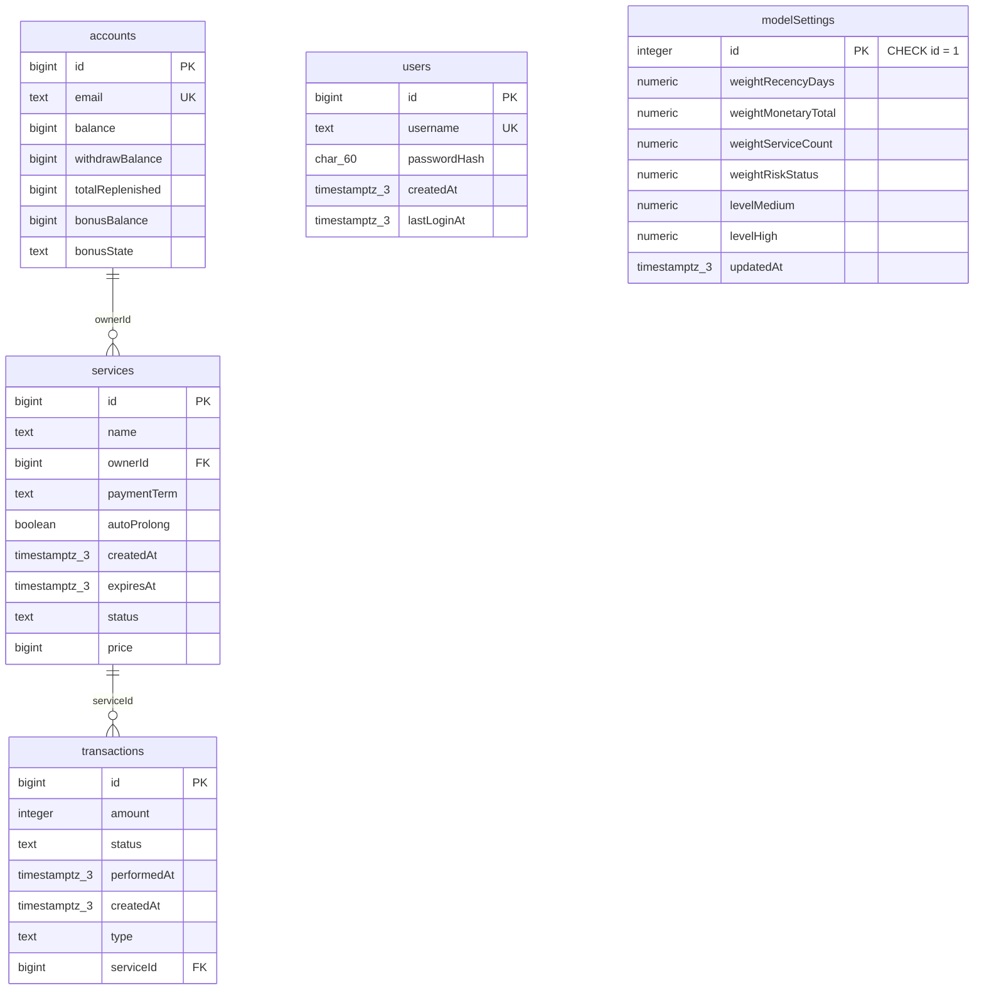

# Проектирование базы данных анализатора рисков оттока (PostgreSQL)

Документ выполнен по методологии книги **«Грокаем проектирование реляционных баз данных»**
(Цян Хао, Михаил Цикердекис; СПб.: Питер, 2026, 272 с.) — главы 3–7.

Объём работ: часть проекта «база данных» (член команды отвечает только за БД).
Базовые таблицы `accounts` / `services` / `transactions` заданы комплектом кейса
(`test-data/001_schema.up.sql`) и сохраняются как есть; проектированию и реализации
подлежат расширения: таблицы аутентификации и настроек модели, индексы, процедура снапшота.

---

## 1. Цели проектирования (книга, гл. 3)

Общая цель — хорошо структурированная и эффективная БД под требования кейса.
Пять целей книги и их реализация в проекте:

| Цель книги | Как обеспечиваем |
|---|---|
| Согласованность и целостность | PK/FK, CHECK по статусам, деньгам, датам; нормализация до 3НФ/BCNF (раздел 4.5) |
| Простота применения и обслуживания | единое соглашение об именовании (раздел 4.6), миграции 001→004, словарь сущностей |
| Производительность и оптимизация | индексы от конкретных запросов панели (раздел 5.3), частичные индексы, singleton-настройки без JOIN |
| Безопасность данных | хеширование паролей bcrypt, роли БД, минимум прав, секреты вне репозитория (раздел 6) |
| Масштабируемость и гибкость | коэффициенты модели — данные, а не код (таблица `modelSettings`); компактные типы; снапшот перезаливает данные без смены схемы |

---

## 2. Этап 1. Сбор требований (книга, гл. 3)

### 2.1 Источники

1. Текст кейса (задание хакатона РНД, уровень MIDDLE).
2. Комплект данных с Яндекс Диска: `001_schema.up.sql`, `001_schema.down.sql`,
   `002_seed.sql`, `data.json`, `generate.py`, `README.md`, `test_generate.py`.
3. Требования к API кейса (эндпоинты, Swagger/OpenAPI, `/metrics`, Docker Compose).

### 2.2 Функциональные требования к данным (из кейса)

- Веб-панель: рисковый **score** каждого клиента, **уровень** риска, **причины** (вклад факторов).
- **Топ клиентов** с двусторонними сортировками (по score, по деньгам).
- **Редактируемые коэффициенты** модели; значения **переживают перезапуск** приложения → хранение в БД.
- **Денежная оценка** потенциальных потерь (цены услуг в евроцентах, €1 = 100).
- **Живое обновление**: данные приходят произвольно в реальном времени.
- **Аутентификация** login + пароль, пользователь заранее создан.
- **`PUT /api/v1/source/snapshot`**: данные поставляются снимком «стереть и залить».
- История статусов и даты удаления **в данных отсутствуют** — никаких таблиц-историй не требуется.
- Обязательные эндпоинты, читающие БД: `GET /api/v1/customers`, `GET /api/v1/customers/{id}`,
  `GET /api/v1/analytics/summary`, `GET|PATCH /api/v1/model/settings`, auth-эндпоинты.

### 2.3 Профиль фактических данных (образцы данных по книге)

`data.json` (seed=42, reference `2026-10-19T15:00:00Z`):

- 10 аккаунтов, 30 услуг, 100 транзакций.
- Статусы услуг: по 6 шт. каждого из 5 (`active`, `blocked`, `deleted`, `suspended`, `prolong_wait`);
  статусы кластеризуются по владельцу (артефакт генератора — учитывать при демо).
- Денежные поля: `balance`, `withdrawBalance`, `totalReplenished`, `bonusBalance`, `price` —
  целые, цены 72..960 евроцентов; `transactions.amount` — целое 0..1000, и `amount` **никогда**
  не равен `price` (100/100 строк).
- Все `prolong_wait` просрочены на месяцы — правило «5 дней → deleted» не отражено во времени:
  **статус ≠ производная от дат**, хранится как самостоятельный признак.
- Даты: `createdAt <= expiresAt` всегда; `performedAt >= createdAt` при `status='performed'`.

### 2.4 Объекты, характеристики, связи (метод книги: существительные + «есть/имеет»)

Из требований выписываем существительные; связка «у X есть Y» отделяет объект от характеристики:

| Объект (сущность) | Характеристики («у X есть …») |
|---|---|
| **Аккаунт клиента** | email, балансы (основной, выводимый, пополнено всего, бонусный), состояние бонуса |
| **Услуга** | название, владелец, срок оплаты, автопродление, создана, истекает, статус, цена |
| **Транзакция** | сумма, статус, исполнена в, создана, тип, услуга |
| **Пользователь панели** | логин, пароль (хеш), создан, последний вход |
| **Настройки модели** | коэффициенты факторов, пороги уровней, обновлено |

Связи (правила кратности):

1. Аккаунт может иметь ноль или несколько услуг. Услуга принадлежит **одному и только одному** аккаунту.
2. Услуга может иметь ноль или несколько транзакций. Транзакция относится к **одной и только одной** услуге.
3. Пользователь панели существует независимо от аккаунтов (связь на уровне приложения).
4. Настройки модели — **ровно одна строка** на всю систему (singleton).

---

## 3. Этап 2. Анализ и составление проекта (книга, гл. 4–6)

### 3.1 Сущности

Пять таблиц: `accounts`, `services`, `transactions` (даны кейсом), `users`, `modelSettings` (новые).

### 3.2 Ключи (книга, гл. 4: «Ключи»)

- Все сущности не имеют удобных естественных ключей (email уникален, но изменяем и громоздок
  для FK) → **суррогатные целочисленные первичные ключи** `bigint GENERATED BY DEFAULT AS IDENTITY`
  — стабильные, уникальные, простые, эффективные; `bigint` выбран с запасом против переполнения
  (книга: SMALLINT/INT достаточно «в среднем», но для растущих журналов событий берут BIGINT).
- Потенциальные ключи, объявленные UNIQUE: `accounts.email`, `users.username`.
- `modelSettings`: первичный ключ `id integer CHECK (id = 1)` — гарантирует ровно одну строку.

### 3.3 Типы данных (книга, гл. 4)

| Свойство | Тип | Обоснование |
|---|---|---|
| Деньги (`balance`, `price`, …) | `bigint`, CHECK ≥ 0 | Кейс фиксирует евроценты (€1 = 100) — целые. FLOAT/DOUBLE исключены: ошибки округления (пример книги с обменой валют: 1 000 001 $ × 0.83 = 830 000.8125 вместо 830 000.83). DECIMAL не нужен: центы уже целые |
| `transactions.amount` | `integer` 0..1000 | Диапазон подтверждён данными и CHECK из кита |
| Статусы, `paymentTerm`, `bonusState`, `type` | `text` + `CHECK (… IN (…))` | Атомарные перечисления. Alternative: `enum`/словарные таблицы — усложняют миграции/JOIN ради 5–6 значений; решение зафиксировано в разделе 7 |
| `name` услуги | `text` + regex CHECK `^[A-Za-z0-9-]+$` | Формат из фактических данных источника |
| Даты/время | `timestamptz(3)` | Книга: TIMESTAMP + UTC для согласованности часовых поясов; точность 3 мс из кита |
| `username` | `text` UNIQUE | Строковый идентификатор входа |
| `passwordHash` | `char(60)` | bcrypt → 40 байт → Base64 = 60 символов (расчёт книги, гл. 7); НЕ обычный текст |
| Коэффициенты/пороги | `numeric` | Точные десятичные для арифметики score |

Кодировка БД — UTF-8 (книга: выбрать как можно раньше; меняется с риском потери данных).

### 3.4 Связи и кратность (книга, гл. 5, нотация «птичьи лапки»)

| Связь | Мин./макс. A→B | Мин./макс. B→A | Внешний ключ |
|---|---|---|---|
| accounts → services | 0 / многие | 1 / 1 | `services."ownerId"` NOT NULL |
| services → transactions | 0 / многие | 1 / 1 | `transactions."serviceId"` NOT NULL |
| users (автономна) | — | — | нет FK: сессии stateless (JWT), таблица сессий не требуется |
| modelSettings (singleton) | 1 / 1 | 1 / 1 | нет; единственность enforced `CHECK (id = 1)` |

- Минимальная кратность на стороне «многие» обнулена (аккаунт без услуг, услуга без транзакций
  допустимы — данные и генератор это подтверждают), при этом FK-столбцы NOT NULL: каждая услуга
  и транзакция обязаны иметь родителя (как «отзыв → пользователь» в книге).
- Связей «многие ко многим» нет; если появятся теги/сегменты клиентов — junction-таблица
  с составным PK по правилам книги.
- Действие FK — `RESTRICT` в обоих направлениях: источник данных сам определяет жизненный
  цикл; БД не каскадно удаляет историю транзакций.

### 3.5 Нормализация: 1НФ → 2НФ → 3НФ/BCNF (книга, гл. 6)

**1НФ.** Во всех таблицах есть PK; многозначных столбцов нет: каждый статус — одно значение,
никаких CSV-списков. История статусов отсутствует по требованию кейса — не храним.

**2НФ.** Все первичные ключи одно-столбцовые суррогатные → частичные зависимости невозможны.
(Аналог «составного ключа» книги здесь не нужен: промежуточных таблиц нет.)

**3НФ/BCNF — поиск транзитивных зависимостей.**

- `services`: `"expiresAt"` не выводим из `"paymentTerm"` + `"createdAt"` — продление сбрасывает
  дату произвольно, это независимый факт источника. `status` — самостоятельный признак
  (данные: `prolong_wait` просрочен на месяцы, т.е. статус ≠ функция от дат).
- `transactions`: `amount` ≠ `price` услуги — это «цена/сумма на момент операции», прямой аналог
  `product_price` в `purchase_product` из книги: сохраняем факт, чтобы история не менялась
  при изменении `price`. Удалить `amount` (взяв из `services.price`) — нельзя: потеряем историю.
- `accounts`: `"totalReplenished"` — агрегат источника (сумма пополнений). Формально это
  денормализация, но её поддерживает поставщик данных, а не наше приложение (обновляется
  только снапшотом) — см. журнал решений, раздел 7.
- Кольца из трёх таблиц нет: `accounts → services → transactions` — линейная цепочка,
  каждый FK зависит только от PK своей таблицы.
- `modelSettings`: каждый коэффициент — отдельный столбец (не JSON-список): атомарность 1НФ
  + типобезопасность и CHECK на каждый коэффициент.

Итог: схема в BCNF (PK есть, столбцы атомарны, полная зависимость от ключа, транзитивных
зависимостей нет).

### 3.6 Именование (книга, гл. 3: соглашения об именовании)

Сохраняем конвенцию кейса: таблицы во множественном числе `snake_case`, столбцы — camelCase
в двойных кавычках. Смешение стилей хуже любого единого стиля — расширения (`users`,
`modelSettings`, индексы) следуют той же конвенции.

### 3.7 ER-диаграмма (Mermaid, нотация «птичьи лапки»)



---

## 4. Этап 3. Реализация (книга, гл. 6–7)

### 4.1 Базовая схема

Схема `test-data/001_schema.up.sql` принимается как есть (ключи, типы, CHECK, FK RESTRICT,
индексы `services_owner_id_idx`, `transactions_service_id_idx`); единственная правка —
удалены `BEGIN;`/`COMMIT;` ради драйверных транзакций `source.py` (см. раздел 9).
Откат — `001_schema.down.sql`, загрузка данных — `002_seed.sql`
(идемпотентный guard, `jsonb_populate_recordset`, `setval`).

### 4.2 Расширение схемы — миграция `003_extend.sql`

Готовый файл: `test-data/003_extend.sql`. Состав:

```sql
BEGIN;

-- Пользователи панели (аутентификация)
CREATE TABLE public.users (
    id bigint GENERATED BY DEFAULT AS IDENTITY PRIMARY KEY,
    username text NOT NULL UNIQUE,
    "passwordHash" char(60) NOT NULL,
    "createdAt" timestamptz(3) NOT NULL DEFAULT CURRENT_TIMESTAMP,
    "lastLoginAt" timestamptz(3)
);

-- Настройки модели риска: singleton-строка, persistence коэффициентов
CREATE TABLE public."modelSettings" (
    id integer PRIMARY KEY CHECK (id = 1),
    "weightRecencyDays" numeric(6,3) NOT NULL DEFAULT 1.000
        CHECK ("weightRecencyDays" >= 0 AND "weightRecencyDays" <= 10),
    "weightMonetaryTotal" numeric(6,3) NOT NULL DEFAULT 1.000
        CHECK ("weightMonetaryTotal" >= 0 AND "weightMonetaryTotal" <= 10),
    "weightServiceCount" numeric(6,3) NOT NULL DEFAULT 1.000
        CHECK ("weightServiceCount" >= 0 AND "weightServiceCount" <= 10),
    "weightRiskStatus" numeric(6,3) NOT NULL DEFAULT 1.000
        CHECK ("weightRiskStatus" >= 0 AND "weightRiskStatus" <= 10),
    "levelMedium" numeric(5,2) NOT NULL DEFAULT 40.00
        CHECK ("levelMedium" > 0 AND "levelMedium" < 100),
    "levelHigh" numeric(5,2) NOT NULL DEFAULT 70.00
        CHECK ("levelHigh" > 0 AND "levelHigh" <= 100),
    CONSTRAINT model_settings_levels_order CHECK ("levelMedium" < "levelHigh"),
    "updatedAt" timestamptz(3) NOT NULL DEFAULT CURRENT_TIMESTAMP
);

INSERT INTO public."modelSettings" (id) VALUES (1);

COMMIT;
```

- `PATCH /api/v1/model/settings` выполняет `UPDATE … , "updatedAt" = CURRENT_TIMESTAMP WHERE id = 1`
  → коэффициенты переживают перезапуск (требование кейса).
- Стартовый пользователь создаётся при первом старте бэкенда
  (`INSERT … ON CONFLICT (username) DO NOTHING`, пароль из ENV, хеш bcrypt при создании).

### 4.3 Индексы (книга, гл. 7: индексируем от запросов приложения)

| Запрос панели | Индекс |
|---|---|
| Фильтр/список услуг по статусу, признак риска | `CREATE INDEX services_status_idx ON public.services (status);` |
| Просрочки/скоро истекающие услуги (деньги под риском) | `CREATE INDEX services_expires_at_idx ON public.services ("expiresAt");` |
| Комбо: риск-статус + срок истечения | `CREATE INDEX services_status_expires_idx ON public.services (status, "expiresAt");` |
| Давность последней оплаты (recency-фактор score) | `CREATE INDEX transactions_performed_idx ON public.transactions ("performedAt");` |
| Последняя оплата конкретной услуги (агрегат для score) | `CREATE INDEX transactions_service_performed_idx ON public.transactions ("serviceId", "performedAt" DESC) WHERE status = 'performed';` — частичный составной |

```sql
CREATE INDEX services_status_idx ON public.services (status);
CREATE INDEX services_expires_at_idx ON public.services ("expiresAt");
CREATE INDEX services_status_expires_idx ON public.services (status, "expiresAt");
CREATE INDEX transactions_performed_idx ON public.transactions ("performedAt");
CREATE INDEX transactions_service_performed_idx
    ON public.transactions ("serviceId", "performedAt" DESC)
    WHERE status = 'performed';
```

Пояснения:

- Индексы по PK и UNIQUE создаются автоматически; **внешние ключи — нет** (книга подчёркивает
  это на примере `review.code`), поэтому существующие `services_owner_id_idx` и
  `transactions_service_id_idx` не лишние: они ускоряют и JOIN'ы панели, и проверку FK/RESTRICT.
- Составной индекс `(status, "expiresAt")` покрывает комбинированные сортировки — приём
  `idx_combo (rating, date)` из книги.
- Частичный индекс `WHERE status = 'performed'` меньше и быстрее: не-исполненные транзакции
  в recency-расчёте не участвуют.

### 4.4 Снапшот: `PUT /api/v1/source/snapshot`

Семантика кейса — «стереть и залить». Порядок удаления определяется FK RESTRICT:
сначала дети (`transactions`), затем `services`, затем `accounts`; заполнение — в обратном
порядке. Шаблон транзакции (параметр — JSON тела запроса):

```sql
BEGIN;
LOCK TABLE public.accounts IN ACCESS EXCLUSIVE MODE;

DELETE FROM public.transactions;
DELETE FROM public.services;
DELETE FROM public.accounts;

INSERT INTO public.accounts (id, email, balance, "withdrawBalance", "totalReplenished", "bonusBalance", "bonusState")
SELECT id, email, balance, "withdrawBalance", "totalReplenished", "bonusBalance", "bonusState"
  FROM jsonb_populate_recordset(null::public.accounts, $1::jsonb);

INSERT INTO public.services (id, name, "ownerId", "paymentTerm", "autoProlong", "createdAt", "expiresAt", status, price)
SELECT id, name, "ownerId", "paymentTerm", "autoProlong", "createdAt", "expiresAt", status, price
  FROM jsonb_populate_recordset(null::public.services, $2::jsonb);

INSERT INTO public.transactions (id, amount, status, "performedAt", "createdAt", type, "serviceId")
SELECT id, amount, status, "performedAt", "createdAt", type, "serviceId"
  FROM jsonb_populate_recordset(null::public.transactions, $3::jsonb);

SELECT setval(pg_get_serial_sequence('public.accounts', 'id'), COALESCE((SELECT MAX(id) FROM public.accounts), 1));
SELECT setval(pg_get_serial_sequence('public.services', 'id'), COALESCE((SELECT MAX(id) FROM public.services), 1));
SELECT setval(pg_get_serial_sequence('public.transactions', 'id'), COALESCE((SELECT MAX(id) FROM public.transactions), 1));

COMMIT;
```

`ACCESS EXCLUSIVE` на родителя блокирует конкурентные чтения/записи на время перезаливки —
панель не увидит полупустую базу. `setval` обязателен: identity-счётчики должны пройти
максимум загруженных id (приём `002_seed.sql`). `users` и `modelSettings` снапшотом не
затрагиваются — это данные приложения, а не источника.

---

## 5. Безопасность (книга, гл. 7)

### 5.1 Целостность

- PK во всех таблицах; FK `RESTRICT`; CHECK: статусные перечисления, деньги ≥ 0,
  `amount BETWEEN 0 AND 1000`, `"expiresAt" >= "createdAt"`, согласованность
  `status`/`performedAt`, порядок порогов уровня. Каждый столбец — оптимальный тип (раздел 3.3).

### 5.2 Конфиденциальность

- **Пароли** — только хеш bcrypt с солью, `char(60)` (книга: bcrypt → Base64 → 60 символов);
  вход: хешировать введённое тем же алгоритмом и сравнить с `"passwordHash"`.
- **RBAC-роли** (подход книги «на основе ролей»):

```sql
CREATE ROLE app_rw NOLOGIN;
GRANT USAGE ON SCHEMA public TO app_rw;
GRANT SELECT, INSERT, UPDATE, DELETE ON ALL TABLES IN SCHEMA public TO app_rw;
GRANT USAGE, SELECT ON ALL SEQUENCES IN SCHEMA public TO app_rw;

CREATE ROLE churn_app LOGIN PASSWORD :'APP_DB_PASSWORD';
GRANT app_rw TO churn_app;
```

  Приложение работает только под `churn_app` (минимум прав: без DDL, без суперпользователя).
  Пароль — из переменных окружения docker-compose, в репозитории и логи не попадает.
- Идентификационные платёжные данные отсутствуют по требованиям кейса — симметричное
  шифрование полей карт (AES-256 → `CHAR(45)`) не требуется; схема остаётся компактной.

---

## 6. Денормализация (книга, гл. 7) — журнал решений

Книга требует фиксировать решения, обоснования, плюсы и минусы.

| # | Решение | Тип | Обоснование | Минусы / контроль |
|---|---|---|---|---|
| 1 | `accounts."totalReplenished"`, `balance` — агрегаты источника | осознанная избыточность | Поддерживаются поставщиком, а не нашим приложением; обновляются только снапшотом | Пересчёт не ведём — исключены расхождения между снапшотами |
| 2 | score/уровень/причины считаются на чтение (SQL/бэкенд), не хранятся | отказ от денормализации | Живое обновление: хранимый score устаревал бы между снапшотами; объём данных мал (10–30 строк на цикл демо) | При росте объёма — materialized view `customer_risk` + `REFRESH` по снапшоту и по таймеру; индекс по score тогда дать на вьюху |
| 3 | Коэффициенты — 6 отдельных столбцов, не JSONB-словарь | структура | Типобезопасность, CHECK на каждый коэффициент, читаемый PATCH | Новый фактор = миграция; для хакатона набор факторов согласован с командой модели |
| 4 | Статусы/термины оплаты — `text`+CHECK, не словарные таблицы | структура | 5–6 значений; словарь добавил бы JOIN без пользы | Расширение значения = правка CHECK (миграция) |

---

## 7. Тестирование (книга, гл. 3: функциональность, производительность, безопасность)

**Сделано:**
- Генератор данных проверен: `python -m unittest` — 3/3 OK (Python 3.14.1).
- Поставка `data.json`/`002_seed.sql` воспроизводится генератором (seed=42) побайтово
  с точностью до концов строк (LF/CRLF).

**Живой прогон выполнен 2026-10-24 — PostgreSQL 16.4 (Zonky embedded binaries, порт 55432, БД `churn`):**
- Миграции `001_schema.up.sql` → `002_seed.sql` → `003_extend.sql` применены без ошибок;
  в БД: `accounts` = 10, `services` = 30, `transactions` = 100, `modelSettings` = 1 (singleton,
  веса 1.000, пороги 40/70), все 5 индексов из п. 4.3 созданы.
- Негативные тесты — 14/14 отклонены верным классом ошибки:
  - `CheckViolation`: `amount` 1001 и −5, `status='performed'` без `"performedAt"`,
    `"performedAt" < "createdAt"`, чужой `status`/`type`, `expiresAt < createdAt`,
    имя услуги вне `^[A-Za-z0-9-]+$`, вторая строка `modelSettings`, вес 10.5 (вне 0..10),
    `levelMedium > levelHigh`;
  - `ForeignKeyViolation`: транзакция с несуществующим `"serviceId"`; `DELETE accounts`
    при наличии услуг (RESTRICT);
  - `UniqueViolation`: повторный `username`.
- Позитивная проверка: пользователь с хэшем ровно 60 символов (`bcrypt`-слот `char(60)`) вставляется.
- Снапшот «стереть и залить» (аналог `PUT /api/v1/source/snapshot`):
  `TRUNCATE transactions, services, accounts RESTART IDENTITY CASCADE` → повторный
  `002_seed.sql`; счётчики восстановлены (10/30/100), целостность 30→10 и 100→30 без
  сирот, `users`/`modelSettings` не затронуты, `nextval` после `setval`: 11 / 31 / 101 —
  identity продолжается без конфликтов.
- Обратимость: `003_extend.down.sql` → `003_extend.sql` проходят цикл down/up.

**Осталось:**
- `EXPLAIN ANALYZE` топ-запросов панели (топ клиентов, summary) — имеет смысл на
  объёме выше 10/30/100 (генератором: 100/300/1000).

---

## 8. Соответствие методологии книги

| Раздел книги | Где применено |
|---|---|
| Гл. 3: цели проектирования | раздел 1 |
| Гл. 3: этапы процесса (сбор требований → проект → реализация/тест) | разделы 2, 3, 4, 7 |
| Гл. 3: объекты/характеристики через «есть/имеет», образцы данных | раздел 2.3, 2.4 |
| Гл. 4: сущности, свойства, первичные ключи, типы данных (VARCHAR/TEXT, INT/BIGINT, DECIMAL vs FLOAT, TIMESTAMP/UTC) | разделы 3.1–3.3 |
| Гл. 5: кратность («птичьи лапки»), обнуление мин. кратности, FK на стороне «многие» | раздел 3.4, 3.7 |
| Гл. 6: 1НФ→2НФ→3НФ/BCNF, транзитивные зависимости, «цена на момент операции» | раздел 3.5 |
| Гл. 7: целостность (PK/FK/CHECK), конфиденциальность (bcrypt 60, RBAC) | разделы 5.1, 5.2 |
| Гл. 7: индексация от запросов, FK не индексируются автоматически, составные индексы | раздел 4.3 |
| Гл. 7: денормализация с документированием решений | раздел 6 |

## 9. Артефакты

- `test-data/001_schema.up.sql`, `001_schema.down.sql`, `002_seed.sql` — даны кейсом.
  **Правка от бэкенда (24.10.2026):** из всех пяти SQL-файлов удалены `BEGIN;`/`COMMIT;` —
  они конфликтуют с транзакцией, которой `source.py` выполняет сид (TRUNCATE сид не содержит,
  он выполняется снаружи). Атомарность при прогоне через psql восстанавливается флагом `psql -1 -f`;
  `LOCK TABLE` и защита «сид только на пустые таблицы» сохранены. Правка перепроверена на живой БД.
- `test-data/003_extend.sql` — новая миграция (users, modelSettings).
- Индексы и снапшот — разделы 4.3, 4.4 (включаются в миграцию/код бэкенда).
- Живой стенд: PostgreSQL 16.4 (Zonky embedded binaries) на `127.0.0.1:55432`, БД `churn`;
  SQL исполняется через psycopg 3 (psql в стенде нет). Запуск сервера — процесс
  `postgres.exe -D pgdata -p 55432`, созданный вне job-объекта шелла (WMI).
